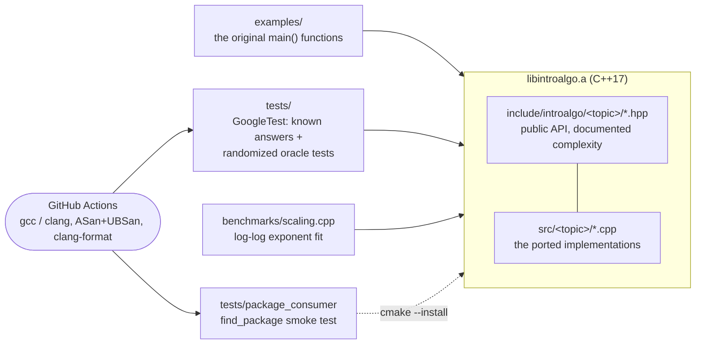

# IntroToAlgo

[](https://github.com/Ctwqk/IntroToAlgo/actions/workflows/ci.yml)

**A small C++17 library of the classic algorithms from an algorithms course (dynamic programming, graphs and
max-flow, simplex, LUP, heaps, hashing, search trees, string matching, ...), each one a header/source pair with
a randomized test suite that checks it against an exhaustive or independent oracle.**

The code started as ~28 standalone, mostly unfinished coursework files. The original implementations are kept
(same classes, same table layouts, same recurrences), but they now build with one CMake project, run as examples,
and are verified. Writing the tests exposed a good number of real bugs; they are listed in
[docs/PORTING_NOTES.md](docs/PORTING_NOTES.md) together with what each original file became.

```text
$ ctest --test-dir build
100% tests passed, 0 tests failed out of 232
  unit       205 tests (known answers + randomized property tests against oracles)
  example     26 tests (every original demo runs to completion)
  benchmark    1 test  (smoke run of the scaling harness)
```

## Features

- 26 modules in 12 topic folders; every algorithm is usable from `#include <introalgo/<topic>/<name>.hpp>`.
- **Tested against oracles, not just examples**: LCS and edit distance vs exhaustive search, max-flow vs brute-force
  minimum cut, simplex vs vertex enumeration and strong duality, heap / hash / BST / red-black / van Emde Boas
  structures vs the C++ standard containers with invariant checkers, MST vs exhaustive spanning-forest search, ...
- Runs clean under **AddressSanitizer + UndefinedBehaviorSanitizer** (gcc and clang) in CI.
- Builds with `-Wall -Wextra -Wpedantic -Wshadow -Werror` on gcc 13/14 and clang 18.
- `cmake --install` exports `introalgo::introalgo` for `find_package(introalgo)`; it also works through
  `add_subdirectory` / `FetchContent` (then only the library is built).
- A scaling benchmark that fits the exponent of `time ~ n^k` for 17 algorithms
  ([sample results](docs/benchmark-results.txt)).
- Every original `main()` is kept as a runnable example ([captured output](docs/examples-output.txt)).

## Architecture



The library modules do not depend on each other; the tests do use `flow_graph` as an independent oracle for
`solar_panels`.

## Algorithms

Complexities are worst-case unless noted; `n`, `m` are input sizes, `k` is a value range,
`d` is a digit count, `u` is the vEB universe, `S` is total stored word length, and `B` is hash bucket count.
Space includes stored data; sorting lists auxiliary space separately. "Tests" links the test file and says what the
implementation is checked against.

| Topic | Module (header) | Problem and approach | Time / space | Tests |
|---|---|---|---|---|
| Divide & conquer | [`out_of_ranking`](include/introalgo/divide_and_conquer/out_of_ranking.hpp) | Count rank inversions (how different are two rankings) with merge sort | O(n log n) / O(n) | [tests](tests/test_out_of_ranking.cpp): O(n^2) pair count, 64-bit overflow case |
| DP | [`lcs`](include/introalgo/dynamic_programming/lcs.hpp) | Longest common subsequence: full table + traceback, and a one-row length-only version | O(nm) / O(nm), length-only auxiliary space O(n); full table allocated only for traceback | [tests](tests/test_lcs.cpp): all 2^n subsequences, all binary strings up to length 4 |
| DP | [`edit_distance`](include/introalgo/dynamic_programming/edit_distance.hpp) | Levenshtein distance | O(nm) / O(nm) | [tests](tests/test_edit_distance.cpp): BFS over the edit graph, metric axioms |
| DP | [`lmis`](include/introalgo/dynamic_programming/lmis.hpp) | Longest strictly increasing subsequence | O(n^2) / O(n) | [tests](tests/test_lmis.cpp): all subsets |
| DP | [`knapsack_01`](include/introalgo/dynamic_programming/knapsack_01.hpp) | 0/1 knapsack, with the chosen items | O(nW) / O(nW) | [tests](tests/test_knapsack_01.cpp): all subsets |
| DP | [`rod_cutting`](include/introalgo/dynamic_programming/rod_cutting.hpp) | Rod cutting (CLRS 15.1); *the original was an empty class* | O(n^2) / O(n) | [tests](tests/test_rod_cutting.cpp): all compositions of n |
| DP | [`obst`](include/introalgo/dynamic_programming/obst.hpp) | Optimal binary search tree, with the tree printed as in the original | O(n^3) / O(n^2) | [tests](tests/test_obst.cpp): enumerates every BST (Catalan) |
| DP | [`bitonic_tour`](include/introalgo/dynamic_programming/bitonic_tour.hpp) | Shortest bitonic Euclidean tour (was `LongSinglePath`); tour reconstruction added | O(n^2) / O(n^2) | [tests](tests/test_bitonic_tour.cpp): all bitonic permutations |
| DP | [`max_quad_exp`](include/introalgo/dynamic_programming/max_quad_exp.hpp) | Largest value of `a op b op ...` over all parenthesizations (max/min table); prints the optimal parenthesization | O(n^3) / O(n^2) | [tests](tests/test_max_quad_exp.cpp): all parenthesizations; the printed expression is re-evaluated by an independent parser |
| Strings | [`kmp`](include/introalgo/strings/kmp.hpp) | Knuth-Morris-Pratt search, all overlapping matches | O(n + m) / O(n + m + matches) including stored strings | [tests](tests/test_kmp.cpp): naive search, prefix function by definition |
| Strings | [`rolling_hash`](include/introalgo/strings/rolling_hash.hpp) | Rabin-Karp matching of DNA (base-4 rolling hash, matches verified) | O(n + m) hashing plus O(m) per hash hit (including true matches), O(nm) worst / O(n + m + matches) | [tests](tests/test_rolling_hash.cpp): naive search, forced hash collisions (tiny moduli) |
| Strings | [`trie`](include/introalgo/strings/trie.hpp) | Trie with per-edge counters: insert, delete (prunes), search, change | O(len) per word operation / O(S) storage | [tests](tests/test_trie.cpp): `std::set` + counter-consistency checker |
| Graphs | [`graph`](include/introalgo/graph/graph.hpp) | Union-find, matrix/adjacency graph, BFS/DFS, cycle detection, two topological sorts, Prim and Kruskal MST, all-pairs shortest paths by min-plus squaring | UF amortized O(alpha(V)); BFS/DFS O(V + E); MST O(V^2 + E log E); `multmat` O(V^3 log V) / O(V^2 + E) storage | [tests](tests/test_graph.cpp): Warshall closure, cycle oracles, exhaustive spanning forests, Floyd-Warshall |
| Graphs | [`flow_graph`](include/introalgo/graph/flow_graph.hpp) | Maximum flow (Edmonds-Karp) with min cut, labelled-vertex wrapper; *the original was a non-compiling sketch* | O(V E^2) / O(V + E) | [tests](tests/test_flow_graph.cpp): brute-force minimum cut, flow conservation, bipartite matching |
| Data structures | [`max_heap`](include/introalgo/data_structures/max_heap.hpp) | Binary max-heap, Floyd build | insert/pop O(log n), build O(n) / O(n) | [tests](tests/test_max_heap.cpp): `std::priority_queue`, heap-property checker |
| Data structures | [`chain_hash`](include/introalgo/data_structures/chain_hash.hpp) | Hash table with separate chaining, sorted insert | expected O(1 + load) / O(n + B) | [tests](tests/test_chain_hash.cpp): `std::multiset`, bucket-placement invariant |
| Data structures | [`bst`](include/introalgo/data_structures/bst.hpp) | Binary search tree with parent pointers (`TreeNode`) plus an owning `Bst` | O(height) / O(n) | [tests](tests/test_bst.cpp): `std::multiset`, BST/parent-link validator |
| Data structures | [`rb_tree`](include/introalgo/data_structures/rb_tree.hpp) | Red-black tree (CLRS 13); *the original was an unfinished draft* | O(log n) / O(n) | [tests](tests/test_rb_tree.cpp): `std::multiset`, full red-black validator every few operations |
| Data structures | [`van_emde_boas`](include/introalgo/data_structures/van_emde_boas.hpp) | van Emde Boas tree: member/insert/delete/successor/predecessor; lazily allocated clusters | queries O(log log u); updates add cluster allocation costs / O(u) worst, O(sqrt(u)) initially | [tests](tests/test_van_emde_boas.cpp): `std::set`; every subset of a universe of 8 |
| Sorting | [`sort`](include/introalgo/sorting/sort.hpp) | Bubble, insertion, selection, quick (two partition schemes), counting and radix sort | O(n^2), O(n^2), O(n^2), O(n^2) (O(n log n) expected), O(n + k), O(d (n + k)) / extra O(1), O(1), O(1), O(log n), O(n + k), O(n + k) | [tests](tests/test_sort.cpp): `std::sort`, stability of counting/radix sort |
| Backtracking | [`constrained_permutations`](include/introalgo/backtracking/constrained_permutations.hpp) | Permutations of 1..n with bounded longest increasing / decreasing subsequence, level-by-level search with pruning | O(n^2 P) / O(nL), where P is visited prefixes and L is peak live states plus results | [tests](tests/test_constrained_permutations.cpp): all `n!` permutations for n <= 7 and every threshold pair; 1764 answers for (9, 3, 3) |
| Greedy | [`solar_panels`](include/introalgo/greedy/solar_panels.hpp) | Match solar-panel packages to houses (smallest sufficient package for the smallest demand) | O(n log n + m log m + nm) / O(n + m) | [tests](tests/test_solar_panels.cpp): exhaustive assignment and a max-flow oracle |
| Linear programming | [`simplex`](include/introalgo/linear_programming/simplex.hpp) | Simplex method (slack form, Bland's rule, auxiliary-variable phase one); *the original file was empty* | exponential worst case, O((m+n)^2) per pivot / O((m+n)^2) | [tests](tests/test_simplex.cpp): vertex enumeration, strong duality, Beale's cycling example, infeasible/unbounded cases |
| Matrix | [`lup`](include/introalgo/matrix/lup.hpp) | LUP decomposition with partial pivoting, linear solves, determinant, inverse | O(n^3) decompose, O(n^2) solve / O(n^2) | [tests](tests/test_lup.cpp): P A = L U residual, cofactor determinant, A A^-1 = I |
| Math | [`optimal_stopping`](include/introalgo/math/optimal_stopping.hpp) | Secretary problem: best number of candidates to reject (200 candidates -> 73, p = 0.3695) | O(n^2) threshold search, O(n) probability query / O(1) | [tests](tests/test_optimal_stopping.cpp): exact enumeration of all arrival orders |
| Geometry | [`rotating_cube`](include/introalgo/geometry/rotating_cube.hpp) | Rotation matrices about x/y/z applied to a cube face, ASCII projection | O(n^2) / O(n^2) points and canvas | [tests](tests/test_rotating_cube.cpp): orthonormality, determinant 1, norm preservation, degree/radian agreement |

All of the above live in namespace `introalgo`; `#include <introalgo/introalgo.hpp>` pulls in everything.

## Quickstart

Requires a C++17 compiler and CMake >= 3.24. GoogleTest is downloaded by CMake (pinned URL and SHA-256), so the
first configure needs network access (or pass `-DINTROALGO_USE_SYSTEM_GTEST=ON`).

```bash
git clone https://github.com/Ctwqk/IntroToAlgo.git
cd IntroToAlgo

cmake -S . -B build                      # Release by default
cmake --build build -j4
ctest --test-dir build --output-on-failure

./build/examples/lcs_demo                # any of the 26 demos
./scripts/run_examples.sh build          # run all of them
./build/benchmarks/scaling               # complexity fit; runtime varies by machine
```

Useful options: `-DINTROALGO_SANITIZE=ON` (ASan + UBSan, use `-DCMAKE_BUILD_TYPE=Debug`),
`-DINTROALGO_WERROR=ON`, `-DINTROALGO_BUILD_TESTS=OFF`, `-DINTROALGO_BUILD_EXAMPLES=OFF`.

### Using the library

```cpp
#include <introalgo/dynamic_programming/lcs.hpp>
#include <introalgo/graph/flow_graph.hpp>

introalgo::Lcs lcs("ABCBDAB", "BDCABA");
lcs.getLCSLength();                       // 4
lcs.getLCS();                             // "BDAB"

introalgo::FlowGraph g(2);
g.addEdge(0, 1, 7);
g.maxFlow(0, 1);                          // 7
```

```cmake
find_package(introalgo REQUIRED)          # after `cmake --install build --prefix <dir>`
target_link_libraries(app PRIVATE introalgo::introalgo)
```

## Sample output

Selected demos (full output: [docs/examples-output.txt](docs/examples-output.txt)):

```text
$ ./build/examples/simplex_demo           # CLRS 29.3: max 3x1 + x2 + 2x3 subject to three constraints
optimal objective: 28
x = (8, 4, 0)

$ ./build/examples/flow_graph_demo        # CLRS figure 26.1
max flow s -> t: 23
  s -> v1: 12/16
  s -> v2: 11/13
  v1 -> v3: 12/12
  v2 -> v4: 11/14
  v4 -> v3: 7/7
  v3 -> t: 19/20
  v4 -> t: 4/4

$ ./build/examples/max_quad_exp_demo "5-8+7*4-8+9"      # best parenthesization (the DP table is printed first)
200
(5-((8+7)*(4-(8+9)))) = 200

$ ./build/examples/obst_demo
root is k5, the OBST expectation is 3.12
the left child of k5 is k2
the right child of k5 is k7
...
```

The scaling benchmark (Release, i9-12900H, one run; the machine was shared, so timings are indicative). `fit k` is
the least-squares slope of log(time) against log(n) over the doubling sizes, `textbook` the exponent to expect;
the full table is in [docs/benchmark-results.txt](docs/benchmark-results.txt):

```text
algorithm                                  expected                    largest n    time (ms)     fit k  textbook
LCS length (one-row DP)                    O(n^2)                           8000        99.79      1.96       2.0
KMP search (worst-case pattern)            O(n)                          2097152         4.81      1.00       1.0
Inversion count (merge sort)               O(n log n)                    1048576       102.93      1.09       1.1
Insertion sort (random input)              O(n^2)                          16000        30.55      1.98       2.0
BST: n sorted inserts (degenerate)         O(n^2)                          32000      1374.14      2.02       2.0
Red-black tree: n sorted inserts           O(n log n)                     524288        38.19      1.10       1.1
LUP decomposition (n x n)                  O(n^3)                            400         7.14      2.70       3.0
```

The unbalanced BST and the red-black tree receiving the same sorted input illustrate why balancing matters:
quadratic against n log n growth. These are measurements from the recorded run, not performance guarantees.

## Testing approach

The latest local verification commands and results are recorded in [docs/VERIFICATION.md](docs/VERIFICATION.md).

- **Known answers** from the textbook (CLRS figures) and from the original programs' demos.
- **Randomized property tests with fixed seeds** (reproducible; the seeds are in the test files): random inputs are
  checked against a brute-force or independent implementation, e.g. 1500 random small LPs against vertex
  enumeration, 600 random flow networks against exhaustive minimum cuts, 400 random expressions against all
  parenthesizations.
- **Invariant checkers** exposed by the data structures (`isMaxHeap()`, `Bst::isValid()`, `RbTree::validate()`,
  `Trie::consistent()`) are called while random operation sequences run against the standard containers.
- **Regression tests** for the bugs in the original code carry a comment describing what the original did.
- CI runs the suite in Release (gcc, clang) and with ASan + UBSan (gcc, clang).

## Project layout

```text
include/introalgo/<topic>/*.hpp   public headers (one per algorithm) + introalgo.hpp umbrella
src/<topic>/*.cpp                 implementations, ported from the original files in place (git mv kept the history)
examples/                         the original main() functions, one executable each (+ assignment6_spam_and_dna)
tests/                            GoogleTest suite (test_<module>.cpp), test_utils.hpp, package_consumer/
benchmarks/scaling.cpp            empirical complexity fit
docs/                             PORTING_NOTES.md, captured example output and benchmark results
scripts/run_examples.sh           runs every example of a build
cmake/                            package config template
.github/workflows/ci.yml          CI
```

## Design notes and trade-offs

- **Original structure first.** Class names (modernized to `PascalCase` where they were lower-case), table layouts,
  recurrences and even awkward method names (`auxilary_merge`, `Hash_func`, `sortedInsert`) were kept where they
  carry meaning; raw `new[]`/pointer plumbing was replaced by `std::vector`/`unique_ptr`, and printing was moved out
  of the algorithms into `show(std::ostream&)` methods or the examples.
- **Honest scope.** Several originals were unfinished (see the table: rod cutting, simplex, flow, red-black tree,
  van Emde Boas, the missing graph algorithms). Those were completed along their own design rather than replaced,
  and are marked as such here and in [docs/PORTING_NOTES.md](docs/PORTING_NOTES.md).
- **Counting and radix sort** refuse value ranges above 2^24 instead of allocating gigabytes.
- **`/` in `max_quad_exp`** is a heuristic: integer division is not monotone in its divisor, so the DP (which keeps
  only the maximum and minimum of each sub-expression) can miss the true maximum when division is involved. It never
  returns a value that no parenthesization produces. `+ - *` are exact.
- **Integer ranges:** knapsack and rod-cutting revenues use `int`; expressions and flow totals use `long long`.
  Unrepresentable evaluated results throw `std::overflow_error`. Expression evaluation rejects overflow in any
  evaluated sub-expression, even if another parenthesization would fit.
- **Floating point:** `simplex` and `lup` use `double` with absolute/relative tolerances; they are meant for small,
  well-scaled problems.

## Known limitations and roadmap

- Released under the [MIT License](LICENSE).
- `graph` stores a dense weight matrix next to the adjacency lists (O(V^2) memory); edges with weight 0 cannot be
  represented, and `multmat` needs non-negative weights.
- The trie uses recursion for traversal and node destruction; extremely long words can exhaust the stack.
- van Emde Boas clusters are allocated lazily, but their pointer arrays still use O(u) memory in the worst case.
- `ConstrainedPermutations` keeps every partial permutation of a level in memory (guarded by a state limit).
- Containers are not templated (`Heap` keys are `int`, ...). Templating them would be a natural next step, as would
  an AVL tree (the original had an empty "below is AVL" placeholder) and an O(n log n) longest-increasing-subsequence
  variant.
- Only Linux (gcc/clang) is exercised in CI; macOS and MSVC are untested.
